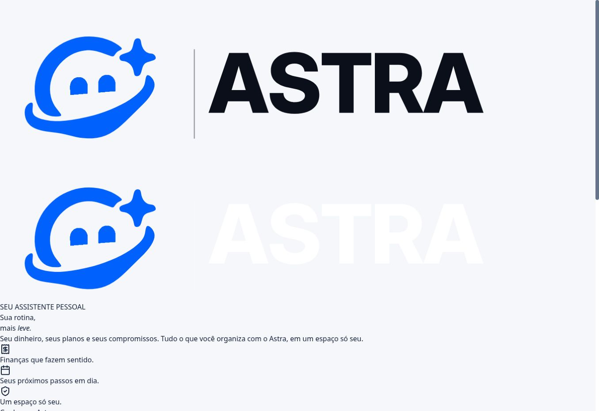
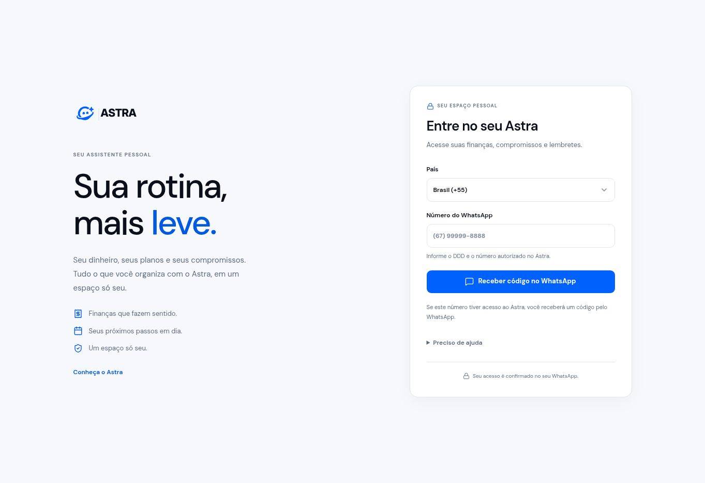

# Astra — validação da interface em 12/11/2026

## Entrega

- Landing: tema noturno nativo conforme a preferência do dispositivo, com superfícies, textos, demonstrações, formulário e páginas institucionais revisados. A versão clara foi preservada.
- Identidade: arquivos oficiais da marca, incluindo a versão branca do logotipo no cabeçalho escuro; azul #0061FD; ícones SVG; sem alteração dos arquivos da logo.
- Portal: painel, perfil e login com tipografia, cores, espaçamento e dimensões consistentes. Próximos compromissos e planejamento aparecem antes dos gráficos e últimos registros.
- Plano: validade real de `customer.access.expiresAt`, data no fuso da conta, dias restantes, vencimento hoje/amanhã, próximo do vencimento, vencido e ausência de data. Exibida no início e no perfil. As permissões continuam controladas pela API.
- Conversão: R$ 19,90/mês; checkout oficial preservado.
- Domínios oficiais: https://astraacessor.pro/ e https://app.astraacessor.pro/cliente/entrar.

## Preservação das alterações recentes

A implementação partiu do commit `3571e882534ba24657e33bba6ba3f6659d5af953`, incluindo as alterações de Pix pendente do usuário. Não há diferença em `packages/core` ou `packages/gateway` nesse conjunto de alterações.

O único ajuste em `integrations/cakto/railway-function.ts` é a formatação necessária para o CI. A árvore sintática TypeScript completa e os valores literais foram comparados com a versão anterior; são equivalentes, desconsiderando parênteses redundantes. O serviço separado de webhook não foi republicado.

Esta entrega não modificou o banco, os dados dos clientes, a conexão do WhatsApp, os provedores de IA, o Ollama, as variáveis de produção, os domínios ou o volume persistente. A imagem final inclui a alteração recente do usuário para confirmação e renovação pelo WhatsApp (`9fd3fb2b972b13d849f7153461e6427e80dc6ef7`); ela foi preservada integralmente. A correção final de estilos (`657284138a4231567af3c27273368633148aafde`) modifica somente o frontend e sua validação.

## Evidências executadas

| Verificação                                                   | Resultado observado                                  |
| ------------------------------------------------------------- | ---------------------------------------------------- |
| Landing: contratos de HTTP, formulário, segurança e navegação | 28 aprovados                                         |
| Landing: navegador, demonstrações, teclado e acessibilidade   | 99 aprovados; 0 falhas; 0 instáveis                  |
| Portal e login: build de produção                             | 156 aprovados; 0 falhas; 0 instáveis                 |
| Unidade: páginas do cliente e entrada do portal               | 114 aprovados                                        |
| Compilação do frontend                                        | Aprovada                                             |
| Formatação completa do repositório                            | Aprovada localmente                                  |
| Landing pública: 15 arquivos em 2 domínios                    | 30 respostas com conteúdo idêntico ao pacote testado |
| robots.txt e sitemap.xml públicos                             | HTTP 200                                             |

Rodadas da implementação funcional:

- Landing: https://github.com/QGBALTIGO/astra/actions/runs/43327360523
- Portal final sobre o build de produção: https://github.com/QGBALTIGO/astra/actions/runs/43331490424
- CI final (compilação, tipos, lint, testes, formatação, cobertura e inicialização): https://github.com/QGBALTIGO/astra/actions/runs/43331490472
- Imagem publicada: https://github.com/QGBALTIGO/astra/actions/runs/43331490174

Referências visuais versionadas: 27 imagens noturnas da landing, além das 27 claras existentes; 36 imagens do portal em Chromium, Firefox e WebKit.

Foram verificadas larguras pequenas, médias, grandes e orientação horizontal; a matriz do portal inclui 320 a 1920 px. As verificações cobrem os cinco destinos do portal, login/OTP, cliques repetidos, inclusão e edição de registros, metas, orçamentos, erros, dados vazios, privacidade de valores, acesso somente leitura, nomes e valores longos, vencimento e teclado. Auditorias automatizadas de acessibilidade cobrem contraste e regras WCAG A/AA aplicáveis às páginas exercitadas.

A auditoria detectou contraste insuficiente no exemplo selecionado da landing escura. A correção usa o azul oficial com texto branco, e a rodada seguinte passou.

## Falha encontrada na validação pública e corrigida

A primeira matriz de 153 testes do portal usava o servidor de desenvolvimento. Ao abrir a versão publicada, o login apareceu sem seus estilos: o pacote de produção carregava o JavaScript do cliente, mas a lista de pré-carregamento da importação condicional omitia o CSS correspondente. As capturas locais de desenvolvimento não detectavam essa diferença.

Os estilos do cliente foram movidos para a entrada principal do documento, preservando seu escopo. A matriz passou a usar `vite preview` sobre o build final e ganhou uma regressão que verifica a grade do login e a proporção da logo. Os 156 testes dessa matriz passaram em Chromium, Firefox e WebKit, sem falhas ou instabilidade, antes da publicação da correção. As referências visuais existentes também passaram.

## Desempenho observado em laboratório

Condições do ensaio: três amostras por versão e dispositivo, 1,6 Mbps, 150 ms de latência e CPU com redução de velocidade de 4 vezes. A referência anterior é a landing preservada antes do redesign original; estes números não isolam o efeito da correção noturna.

| Dispositivo     | LCP mediano antes/depois | CLS antes/depois | Tarefas longas antes/depois |
| --------------- | ------------------------ | ---------------- | --------------------------- |
| Mobile 390 px   | 696 / 676 ms             | 0,123 / 0        | 115 / 42 ms                 |
| Desktop 1440 px | 776 / 676 ms             | 0,110 / 0        | 144 / 44 ms                 |

São medições de laboratório, não dados reais do percentil 75. A duração máxima dos eventos observados foi 56 ms no mobile e 64 ms no desktop após a alteração; não equivale a uma medição de INP de campo.

## Produção e reversão

A landing foi publicada na Function existente, Bun 1.4.4, no deploy `a6657c88-b0f4-4d1f-83c8-50f6a606636e`, com estado `SUCCESS`.

Pacote testado/publicado: SHA-256 `64e4a22d0cf06ded4ea719550661ca602ceb1c51ff2e4d44e8d3d78cd52d4791`. Os 15 arquivos públicos foram comparados byte a byte com o pacote em https://astraacessor.pro e na origem Railway. A demonstração de metas foi executada no domínio oficial e atualizou a conversa e o painel ilustrativo.

Reversão da landing: `landing/rollback/production-before-night.ts`, correspondente à produção anterior, deploy `96ccc1d0-f7a8-44e7-bc6b-7bfaa6a8b549`.

O portal foi publicado com `ghcr.io/qgbaltigo/astra:sha-657284138a4231567af3c27273368633148aafde`, no deploy `65c41faa-527d-4e3b-a3ac-431d96024b4a`, com estado `SUCCESS`. O volume `/app/data` manteve o mesmo ID e as configurações existentes foram preservadas.

Os dois scripts executáveis de entrada do portal foram comparados byte a byte com o artefato testado e são idênticos. Todas as 761 regras de estilo e fontes do cliente também são idênticas; hash da comparação: `2dd2d56d5a3ff7273bc8430d69e7c248e1e1034bec8cc9dc76aa1b1797ae5461`. Os nomes dos assets e o CSS global diferiram entre os ambientes de build; por isso a comparação utiliza o conteúdo efetivo dos scripts e as regras completas do portal. Login e `/health` responderam HTTP 200.

O login público foi reaberto após a atualização do cache da aplicação e conferido visualmente: grade ativa, logo com 150 px e cartão com 430 px na janela de desktop observada. Nenhum campo de telefone foi enviado e nenhum OTP real foi solicitado.

Registros anteriores preservados para recuperação: imagem `sha-0350393b3941d190e5a2b5cd61b0cdf6ee955473` e deploy `73657d36-a585-4b8d-919d-38904662b0db`. A imagem intermediária `sha-9fd3fb2b972b13d849f7153461e6427e80dc6ef7` inclui as novas notificações do usuário, mas apresenta a falha de CSS descrita acima; não deve ser usada como reversão visual. Nenhuma reversão foi executada.

### Capturas reais do mesmo endereço público

Antes da correção do carregamento de CSS:

Depois da publicação e conferência:

## Limites da validação

- Os fluxos autenticados e OTP foram exercitados com respostas sintéticas isoladas; nenhuma mensagem, compra ou pagamento real foi disparado.
- Os tamanhos e navegadores são automações e emulações, não testes em aparelhos físicos.
- A prévia local pelo navegador desta sessão foi bloqueada pelo ambiente. As capturas e a matriz de navegação foram produzidas de fato no GitHub Actions; a landing pública também foi aberta e utilizada no navegador desta sessão.
- A auditoria automatizada complementa a inspeção visual; não constitui certificação completa de acessibilidade.
